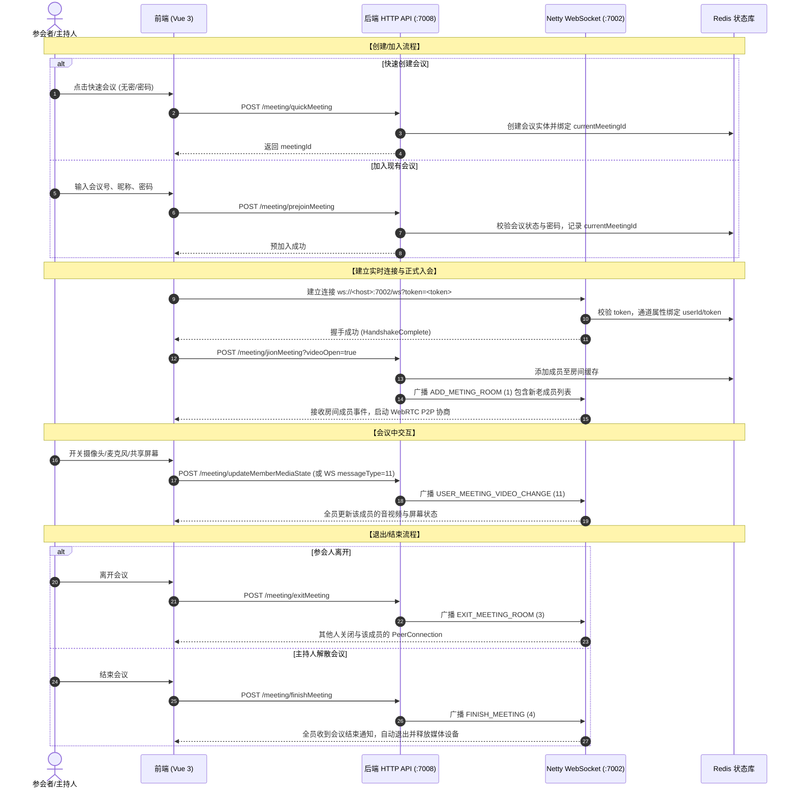

# EasyMeeting 前后端技术审计与对接规范文档

> **审计基准仓库**：`D:\java\project\easymeeting-java`  
> **审计模块**：`easymeeting-web`、`easymeeting-common`、`easymeeting-admin`  
> **生成时间**：2026-10-29  
> **审计责任主体**：EasyMeeting 前端工程团队

---

## 目录
1. [后端系统架构与实际具备的功能概览](#一后端系统架构与实际具备的功能概览)
2. [HTTP 业务接口全量审计与数据契约](#二http-业务接口全量审计与数据契约)
3. [身份认证机制、Token 传递与安全处理](#三身份认证机制token-传递与安全处理)
4. [会议核心业务流程全景（创建/加入/退出/结束/互踢）](#四会议核心业务流程全景)
5. [WebSocket 实时信令与消息系统审计](#五websocket-实时信令与消息系统审计)
6. [WebRTC 音视频通信机制与 P2P Mesh 交换流程](#六webrtc-音视频通信机制与-p2p-mesh-交换流程)
7. [NAT 穿透、STUN/TURN 与屏幕共享能力评估](#七nat-穿透stunturn-与屏幕共享能力评估)
8. [后端缺失能力、接口死角与不确定项记录](#八后端缺失能力接口死角与不确定项记录)
9. [前端与后端状态映射、字段拼写陷阱与转换字典](#九前端与后端状态映射字段拼写陷阱与转换字典)

---

## 一、后端系统架构与实际具备的功能概览

### 1.1 模块架构与部署拓扑
- **Spring Boot Web 服务**：
  - 端口：`7008`
  - 上下文路径：`/api`（即所有 HTTP 接口基准前缀均为 `http://<host>:7008/api`）
- **Netty WebSocket 信令服务器**：
  - 独立运行于 Netty 服务线程，端口：`7002`
  - 握手路径：`ws://<host>:7002/ws?token=<token>`
- **数据与中间件层**：
  - MySQL 数据库：持久化用户信息、会议记录、参会成员、联系人关系、联系人申请、邀请链接及邮箱验证码。
  - Redis 集中缓存：存储 Token 会话（TTL 7天）、会议房间在线成员（Hash/List）、验证码（TTL 1分钟）、会议聊天历史记录、用户在线映射。
  - Redisson 分布式信令广播：基于 Redis Pub/Sub（Topic: `message.topic`）支持多节点跨服务器信令推送。
- **模块分工现状**：
  - `easymeeting-common`：数据模型（PO/DTO/Query/VO）、枚举、异常拦截、Netty WebSocket、Redisson、邮件与文件处理。
  - `easymeeting-web`：对外 REST Controller 核心服务。
  - `easymeeting-admin`：目前代码为空骨架，尚未包含实际管理端业务。

### 1.2 实际已完整实现的功能清单
1. **账号认证体系**：数学算术算式动态 Gif 图形验证码生成与校验、QQ 邮箱验证码发送、用户账号密码注册（MD5 加密存储）、账号密码登录、Token 生成与 Redis/Cookie 双写。
2. **会议全生命周期管理**：
   - 快速创建会议（支持个人专属会议号或 10 位随机生成号，支持免密或密码保护）。
   - 预加入会议合法性校验（检查会议状态、密码、冲突在会状态）。
   - 正式加入会议并向全员广播成员上线事件。
   - 会议在线成员列表获取与媒体状态同步。
   - 参会人自主退出会议（全员离开自动结束会议）。
   - 主持人解散/结束会议（全员强制下线）。
   - 主持人踢出成员、拉黑成员（不可再进入）。
   - 参会人音视频开关与屏幕共享状态同步（房间内单人互斥共享校验）。
   - 主持人全员一键静音/解除静音。
   - 调整预约会议时间并通过 JavaMailSender 向全员发送邮件变动提醒。
3. **会议邀请系统**：
   - 生成会议邀请码及直达分享链接（支持自定义有效期、免密入会选项、最大使用次数限制、备注）。
   - 解析邀请码详情（会议主题、主持人、有效期、免密状态）。
   - 基于邀请码免密/输密一键加入会议。
   - 批量输入邮箱地址直接发送会议邀请函邮件。
   - 作废/取消已有会议邀请。
4. **实时信令与 WebRTC 中继**：
   - 基于 Netty WebSocket 实现 P2P Mesh 模式的信令穿透转发（Offer、Answer、ICE Candidate）。
   - 客户端心跳保活（`ping` -> `pong`，60秒读空闲剔除）。
   - 房间内信令与用户点对点私信信令路由。
5. **会议聊天与多媒体传输**：
   - HTTP 与 WebSocket 双通道文字聊天发送与防 XSS 注入过滤。
   - 支持房间内公屏群聊与成员间 1 对 1 私聊。
   - 会议聊天历史拉取（私聊消息严格隔离，仅收发双方可见）。
   - 会议文件及多媒体上传、持久化存储到本地磁盘、生成元信息入 Redis。
   - 上传后自动触发 `CHAT_MEDIA_MESSAGE` WebSocket 广播通知全体参会人员。
   - 文件安全下载与内嵌预览（图片/音视频/PDF 支持）。
6. **通讯录与联系人管理**：
   - 联系人搜索（支持精准 ID/邮箱、模糊昵称搜索，返回与当前用户的加友关系）。
   - 发送好友申请（附加申请附言）。
   - 审批好友申请（同意、拒绝、拉黑）。
   - 通讯录好友列表加载（附带在线状态和在会状态）。
   - 分页加载好友申请历史。
   - 修改联系人备注、删除联系人好友。
   - 会议中向通讯录好友直接发送实时呼叫邀请信令并附带邮件邀请函。
7. **客户端版本检查**：
   - `/update/checkVersion` 接口骨架。

---

## 二、HTTP 业务接口全量审计与数据契约

后端统一采用统一响应包装结构 `ResponseVO<T>`：
```json
{
  "status": "success" | "error",
  "code": 200, // 200: 成功; 600: 业务参数错误; 901: 登录超时/失效; 500: 服务器错误
  "info": "提示信息",
  "data": null // 业务载荷对象
}
```

### 2.1 账号与认证模块 (`/api/account`)
| 接口地址 | 方法 | 参数列表 | 参数格式 | 响应 data 结构 | 说明 |
| :--- | :---: | :--- | :--- | :--- | :--- |
| `/account/checkCode` | GET/POST | `type`: 0-登录/注册(默认), 1-邮箱验证码 | Query/Form | `{"checkCodeKey":"UUID","checkCode":"data:image/gif;base64,..."}` | 生成算术 GIF 验证码，用户需计算算式输入数值结果 |
| `/account/sendEmailCode` | POST | `email`: 邮箱地址<br>`checkCodeKey`: 验证码Key<br>`checkCode`: 验证码计算结果数值<br>`type`: 0-注册(默认) | Form/Query | `null` | 需携带 `type=1` 产生的图形验证码结果验证通过后发送 |
| `/account/register` | POST | `email`: 邮箱<br>`nickName`: 昵称<br>`password`: 明文密码<br>`emailCode`: 邮箱验证码<br>`checkCodeKey`: 图形码Key<br>`checkCode`: 图形码计算结果 | Form/Query | `null` | 密码采用 MD5 加密存储，校验通过后创建新用户 |
| `/account/login` | POST | `email`: 邮箱<br>`password`: 明文密码<br>`checkCodeKey`: 图形码Key<br>`checkCode`: 图形码计算结果 | Form/Query | `TokenUserInfoDto` (见下方详细字段) | 登录成功后后端自动注入 Cookie `token` 并返回 Token 用户信息 |

**`TokenUserInfoDto` 返回结构**：
- `userId` (String): 用户全局唯一标识
- `userName` (String): 用户名
- `nickName` (String): 用户昵称
- `token` (String): 会话认证令牌（UUID）
- `expireAt` (Long): 过期时间戳（毫秒，7天有效）
- `sex` (Integer): 性别（0:女 1:男）
- `admin` (Boolean): 是否管理员
- `currentMeetingId` (String): 当前所在会议ID（若有正在进行的会议）

---

### 2.2 会议核心控制模块 (`/api/meeting`)
| 接口地址 | 方法 | 请求参数 | 响应 data 结构 | 说明 |
| :--- | :---: | :--- | :--- | :--- |
| `/meeting/getCurrentMeeting` | GET/POST | 无 | `MeetingInfo` 或 `null` | 检查当前登录用户是否有进行中但未退出的会议 |
| `/meeting/quickMeeting` | POST | `meetingNoType`: 0-使用个人ID, 1-系统随机10位号<br>`meetingName`: 会议主题<br>`jionType`: 0-无密码, 1-需要密码<br>`jionPassword`: 会议密码 | `meetingId` (String) | 创建并直接初始化快速会议，创建者自动设为主持人 |
| `/meeting/prejoinMeeting` | POST | `meetingNo`: 会议号<br>`nickName`: 参会昵称<br>`password`: 会议密码（无密码时可为空） | `null` | 校验会议状态与密码，成功后将当前用户绑定到该会议缓存中 |
| `/meeting/jionMeeting` | POST | `videoOpen`: Boolean（是否初始开启摄像头） | `null` | **注意拼写为 jion**。正式进入会议房间，向房间全员广播入会信令 |
| `/meeting/getMeetingMemberList` | GET/POST | `meetingId`: 会议ID（可选，默认当前用户会议） | `List<MeetingMemberDto>` | 获取房间内在线成员列表及麦克风/摄像头/屏幕共享状态 |
| `/meeting/exitMeeting` | POST | `meetingId`: 会议ID（可选，默认当前用户会议） | `null` | 成员主动离开会议，清理房间缓存，广播成员离开消息 |
| `/meeting/finishMeeting` | POST | `meetingId`: 会议ID（可选，默认当前用户会议） | `null` | 主持人主动解散会议，会议标记 FINISHED 并踢出全员 |
| `/meeting/kickOutMember` | POST | `meetingId`: 会议ID<br>`targetUserId`: 目标被踢成员ID | `null` | 主持人权限；私发强制下线通知并将其移出会议 |
| `/meeting/blacklistMember` | POST | `meetingId`: 会议ID<br>`targetUserId`: 目标成员ID | `null` | 主持人权限；将其拉黑，写入黑名单状态，不可再次加入该会议 |
| `/meeting/updateMemberMediaState` | POST | `meetingId`: 会议ID<br>`openVideo`: Boolean（可选）<br>`openAudio`: Boolean（可选）<br>`screenShare`: Boolean（可选） | `null` | 更新自身媒体设备开关及屏幕共享状态，屏幕共享在房间内互斥 |
| `/meeting/muteAll` | POST | `meetingId`: 会议ID<br>`mute`: Boolean（true-全员静音，false-解除） | `null` | 主持人权限；一键静音除主持人外的全员麦克风 |
| `/meeting/sendChatMessage` | POST | `message`: 消息正文<br>`receiveUserId`: 接收人ID（私聊时必传，群聊置空） | `MessageSendDto` | HTTP 通道发送文本聊天，后端防 XSS 并广播入 Redis 历史 |
| `/meeting/loadChatMessage` | GET/POST | `meetingId`: 会议ID（可选，默认当前会议） | `List<MessageSendDto>` | 加载会议历史消息，私聊记录服务端已做双方可视性过滤 |
| `/meeting/generateInvite` | POST | `meetingId`: 会议ID<br>`expireHours`: 有效期小时数（默认24）<br>`allowPasswordFree`: 0-否 1-是（默认1免密）<br>`maxUseCount`: 最大次数（-1无限制）<br>`remark`: 备注 | `MeetingInviteDto` | 生成会议邀请直达链接和格式化剪贴板文案 |
| `/meeting/parseInviteCode` | GET/POST | `inviteCode`: 邀请码（8位字符串） | `MeetingInviteDto` | 查看邀请详情、过期状态及是否需要密码 |
| `/meeting/joinByInviteCode` | POST | `inviteCode`: 邀请码<br>`password`: 入会密码（非免密时需填） | `MeetingInviteDto` | 通过邀请链接/邀请码入会，支持免密校验跳过 |
| `/meeting/sendInviteEmail` | POST | `meetingId`: 会议ID<br>`emails`: 目标邮箱（多个英文逗号分隔）<br>`expireHours`: 有效期<br>`allowPasswordFree`: 0或1 | `MeetingInviteDto` | 服务端调用 SMTP 发送会议邀请邮件通知 |
| `/meeting/cancelInvite` | POST | `inviteId`: 邀请ID | `null` | 作废指定的邀请链接 |
| `/meeting/updateMeetingTime` | POST | `meetingId`: 会议ID<br>`startTime`: yyyy-MM-dd HH:mm:ss<br>`endTime`: yyyy-MM-dd HH:mm:ss<br>`changeReason`: 调整原因 | `null` | 调整会议时间并触发邮件通知全员 |

---

### 2.3 会议预约与历史模块 (`/api/meetingReserve` 或 `/api/meetingResver`)
| 接口地址 | 方法 | 请求参数 | 响应 data 结构 | 说明 |
| :--- | :---: | :--- | :--- | :--- |
| `/meetingReserve/LoadTodayMeeting` | GET/POST | 无 | `List<MeetingInfo>` | **注意方法名大写 L**；查询当前用户正在进行中的会议列表 |
| `/meetingReserve/loadMeeting` | GET/POST | `pageNo`: 当前页码（从1开始） | `PaginationResultVO<MeetingInfo>` | 分页查询当前用户创建或参加的会议记录（带参会人数统计） |
| `/meetingReserve/updateMeetingTime` | POST | 与 meeting 模块一致 | `null` | 兼容旧路径的时间调整接口 |

**`PaginationResultVO<T>` 分页结构注意点**：
- `totalCount` (Integer): 总记录数
- `pageNO` (Integer): **注意大写 NO**
- `pageSize` (Integer): 每页条数（默认15）
- `pageTotal` (Integer): 总页数
- `list` (List\<T\>): 数据数组

---

### 2.4 通讯录与联系人模块 (`/api/userContact`)
| 接口地址 | 方法 | 请求参数 | 响应 data 结构 | 说明 |
| :--- | :---: | :--- | :--- | :--- |
| `/userContact/searchContact` | GET/POST | `searchKey`: 搜索关键词（邮箱/用户ID/昵称） | `List<UserContactSearchResultDto>` | 搜索系统用户，包含好友关系状态（0:非好友 1:是好友 2:申请中 3:自己） |
| `/userContact/applyContact` | POST | `receiveUserId`: 目标用户ID<br>`applyInfo`: 申请附言 | `null` | 向指定用户发起好友申请 |
| `/userContact/dealWithApply` | POST | `applyId`: 申请记录ID<br>`status`: 1-同意, 2-拒绝, 3-拉黑 | `null` | 处理收到的好友申请 |
| `/userContact/loadContactList` | GET/POST | 无 | `List<UserContactDto>` | 获取好友列表，字段含 `isOnline` 和 `currentMeetingId` |
| `/userContact/loadApplyList` | GET/POST | `pageNo`: 页码 | `PaginationResultVO<UserContactApplyDto>` | 分页加载当前用户收到的好友申请记录 |
| `/userContact/loadContactApplyDealWithDeal` | GET/POST | `pageNo`: 页码 | 同上 | 兼容历史命名接口 |
| `/userContact/updateRemark` | POST | `contactId`: 好友用户ID<br>`remark`: 备注名 | `null` | 修改好友备注名 |
| `/userContact/delContact` | POST | `contactId`: 好友用户ID | `null` | 双向解除好友关系 |
| `/userContact/inviteContactToMeeting` | POST | `meetingId`: 会议ID<br>`contactId`: 目标好友ID | `null` | 会议中一键呼叫好友入会（发送实时信令并发送邀请邮件） |

---

### 2.5 文件与多媒体共享模块 (`/api/file`)
| 接口地址 | 方法 | 请求参数 | 响应 data 结构 | 说明 |
| :--- | :---: | :--- | :--- | :--- |
| `/file/uploadFile` (或 `/file/upload`) | POST (Multipart) | `file`: 二进制文件<br>`meetingId`: 会议ID（可选）<br>`receiveUserId`: 私发用户ID（可选） | `FileInfoDto` | 上传会议文件或附件，存储在服务器并自动向会议房间广播媒体消息 |
| `/file/download/{fileId}` | GET | Path 变量 `fileId` | 二进制流 | 下载指定文件，带 `Content-Disposition` 附件响应头 |
| `/file/downloadFile` | GET | Query 参数 `fileId` | 二进制流 | 兼容参数方式下载 |
| `/file/getResource/{fileId}` | GET | Path 变量 `fileId` | 二进制流 | 内嵌预览资源（支持图片、MP4、MP3、PDF 直接渲染） |

---

### 2.6 系统更新模块 (`/api/update`)
| 接口地址 | 方法 | 请求参数 | 响应 data 结构 | 说明 |
| :--- | :---: | :--- | :--- | :--- |
| `/update/checkVersion` | GET/POST | 无 | `null` | 客户端版本校验骨架 |

---

## 三、身份认证机制、Token 传递与安全处理

### 3.1 认证凭证与生命周期
1. **生成与存储**：
   - 用户登录成功（`/account/login`）后，服务端生成 36 位 UUID 格式的 `token`。
   - Token 存储在 Redis 中，Key 为 `easymeeting:token:web:<token>`，TTL 为 7 天。
   - 伴随建立 `easymeeting:ws:userId:<userId>` 映射到当前有效 `token`。
2. **多重凭据提取机制**：
   - 后端基类 `AbaseController.GetTokenUserInfo()` 支持以下 3 种途径按优先级获取 Token：
     1. 请求头 `token: <token>`（推荐前端统一使用 Header 方式注入）。
     2. 请求参数 `?token=<token>`。
     3. 浏览器 Cookie `token=<token>`（后端登录时会自动执行 `response.addCookie`，path=`/`，maxAge=24小时）。
3. **过期与无权限响应判定**：
   - 当 Token 不存在或已过期时，后端抛出 `ResponseCodeEnum.CODE_901`（code: `901`, info: `"登录超时"`）或业务异常（code: `600`, info: `"用户未登录"`）。
   - 前端 Axios 拦截器必须监听响应体中 `code === 901` 或提示未登录的异常，立即清理本地持久化数据并重定向至 `/login`。
4. **前端安全存储策略**：
   - 采用 `localStorage` 保存用户信息和 `token`，并在 Axios 请求拦截器中自动附加请求头 `token: tokenValue`。
   - 严禁将用户明文密码存入浏览器本地存储。

---

## 四、会议核心业务流程全景



---

## 五、WebSocket 实时信令与消息系统审计

### 5.1 连接与握手规范
- **URL**：`ws://<host>:7002/ws?token=<token>`
- **握手鉴权流程**：
  - Netty `HandlerTokenValidation` 拦截 HTTP Upgrade 请求。
  - 从 URI 查询参数中提取 `token`，并在 Redis 中核验是否存在用户会话。
  - 校验失败立即返回 HTTP 401 Unauthorized 并关闭 TCP；校验成功则把 `userId` 与 `token` 挂载到 Channel Attribute 上，放行进入 WebSocket 协议帧处理器。

### 5.2 心跳保活机制
- **心跳规范**：
  - 客户端定时（建议每 25 秒）通过 WebSocket 发送纯字符串文本：`ping`。
  - 服务端 `HandlerWebSocket` 检测到 `"ping"`，立即回传纯字符串文本：`pong`。
  - Netty 端配置了 60 秒读空闲检测（`IdleStateHandler(60, 0, 0)`），若超过 60 秒未收到任何数据（包括 ping），服务端主动断开连接。

### 5.3 消息类型与枚举对照表 (`MessageTypeEnum`)
| 枚举值 | 英文标识 | 传输方向 | 作用与说明 |
| :---: | :--- | :---: | :--- |
| `0` | `INIT` | S -> C | 连接初始化通知 |
| `1` | `ADD_METING_ROOM` | S -> C | **服务端拼写为 METING**。成员加入房间，载荷为 `MeetingJionDto`（新成员 + 成员列表） |
| `2` | `PEER` | C <-> S <-> C | WebRTC P2P 信令（Offer, Answer, Candidate）透传 |
| `3` | `EXIT_MEETING_ROOM` | C -> S / S -> C | 成员退出会议通知，载荷为退出者的 `userId` |
| `4` | `FINISH_MEETING` | S -> C | 主持人结束会议通知，全员被强制退出 |
| `5` | `CHAT_TEXT_MESSAGE` | C <-> S <-> C | 文字聊天消息（支持公屏广播与指定接收人的私聊） |
| `6` | `CHAT_MEDIA_MESSAGE` | S -> C | 文件上传后的媒体通知，载荷为 `FileInfoDto` |
| `7` | `CHAT_MEDIA_MESSAGE_UPDATE` | S -> C | 媒体消息状态变更 |
| `8` | `USER_CONTACT_APPLY` | S -> C | 好友添加申请实时推送通知 |
| `9` | `INVIT_MEMBER_MEETING` | S -> C | **服务端拼写为 INVIT**。会议呼叫邀请通知 |
| `10` | `FORCE_OFF_LINE` | S -> C | 强制下线（被主持人踢出或拉黑时私发） |
| `11` | `USER_MEETING_VIDEO_CHANGE`| C <-> S <-> C | 成员麦克风/摄像头/屏幕共享状态变更通知 |
| `12` | `USER_CONTACT_DEAL_WITH` | S -> C | 好友申请审批结果推送 |

### 5.4 关键信令消息体结构（以 `MessageSendDto` 为准）
服务端推送的所有 JSON 消息外层均为 `MessageSendDto`：
```json
{
  "messageType": 2,
  "messageSend2Type": 0, // 0: 群发广播, 1: 点对点私发
  "meetingId": "M1001",
  "userId": "senderUserId",
  "sendNickName": "张三",
  "receiveUserId": "targetUserId",
  "sendTime": 1730123456789,
  "messageId": 1730123456789,
  "meesageContent": { ... } // 注意拼写为 meesageContent
}
```

---

## 六、WebRTC 音视频通信机制与 P2P Mesh 交换流程

### 6.1 架构模型
后端**不具备 SFU / MCU 媒体服务器能力**，现有的架构是典型的 **Full Mesh P2P 网络**：
- 每一个参会者与房间内的其他每一位参会者之间，都建立一条独立的 `RTCPeerConnection` 连接。
- 适合小型会议（2-6 人）。随着参会者增加，上行与下行带宽压力和编解码压力呈 $O(N^2)$ 递增。

### 6.2 信令交换协议格式
客户端向服务端发送 WebRTC 信令时，既可发送简要 JSON，也可完整发送 `MessageSendDto`：
```json
{
  "messageType": 2,
  "signalType": "offer" | "answer" | "candidate",
  "signalData": "{\"type\":\"offer\",\"sdp\":\"v=0...\"}", // 序列化后的 SDP 或 Candidate 字符串
  "receiveUserId": "目标成员的 userId"
}
```
服务端解析后，自动将其封装为 `MessageSendDto<PeerMessageDto>` 并定向转发至 `receiveUserId` 的 WebSocket 连接上。

### 6.3 Mesh 连接建立全流程
1. **新成员加入触发**：
   - 用户 B 进入房间并调用 `/meeting/jionMeeting`。
   - 用户 A（老成员）收到 WebSocket 广播 `messageType = 1`（`ADD_METING_ROOM`），得到 `newMember.userId == B`。
2. **主动发起协商（Offerer）**：
   - 用户 A 为用户 B 创建 `pc_B = new RTCPeerConnection(rtcConfig)`。
   - 用户 A 将本地音视频轨道通过 `pc_B.addTrack(track, localStream)` 添加进去。
   - 用户 A 监听 `pc_B.onicecandidate`，每收集到一个 candidate，立即发送：
     ```json
     { "messageType": 2, "signalType": "candidate", "signalData": JSON.stringify(candidate), "receiveUserId": "B" }
     ```
   - 用户 A 执行 `const offer = await pc_B.createOffer()`，`await pc_B.setLocalDescription(offer)`。
   - 用户 A 发送 Offer 信令：
     ```json
     { "messageType": 2, "signalType": "offer", "signalData": JSON.stringify(offer), "receiveUserId": "B" }
     ```
3. **被动响应协商（Answerer）**：
   - 用户 B 收到 `messageType = 2` 且 `signalType == "offer"`，来源为用户 A。
   - 用户 B 为用户 A 创建 `pc_A = new RTCPeerConnection(rtcConfig)`。
   - 用户 B 添加本地音视频轨道到 `pc_A`。
   - 用户 B 绑定 `pc_A.ontrack = (event) => { remoteStream_A = event.streams[0] }`。
   - 用户 B 执行 `await pc_A.setRemoteDescription(new RTCSessionDescription(JSON.parse(signalData)))`。
   - 用户 B 执行 `const answer = await pc_A.createAnswer()`，`await pc_A.setLocalDescription(answer)`。
   - 用户 B 回发 Answer 信令给用户 A。
4. **应答完成与连接就绪**：
   - 用户 A 收到 Answer 信令后，执行 `await pc_B.setRemoteDescription(new RTCSessionDescription(JSON.parse(signalData)))`。
   - 双方收到候选者信令后，调用 `pc.addIceCandidate(new RTCIceCandidate(candidate))`。
   - WebRTC 握手完成，音视频双向流通。

---

## 七、NAT 穿透、STUN/TURN 与屏幕共享能力评估

### 7.1 STUN/TURN 能力审计
- **后端现状**：Java 后端代码与配置文件中，**完全没有内置 STUN/TURN 服务器**，也未暴露获取 ICE Server 配置的动态接口。
- **连通性限制**：
  - 本地局域网（LAN）或同台机器多标签页测试：Direct Host Candidate 即可完全连通。
  - 公网复杂 NAT（对称型 NAT / 企业防火墙）：必须由前端默认配置公网免费 STUN 服务器（如 `stun:stun.l.google.com:19302`、`stun:stun1.l.google.com:19302`）。若两端均处于对称 NAT 后，由于缺乏 TURN 中继服务器，P2P 媒体打洞可能会失败。
- **浏览器安全上下文要求**：
  - `navigator.mediaDevices.getUserMedia` 与 `getDisplayMedia` 仅在 `https://` 或 `http://localhost` / `http://127.0.0.1` 安全上下文中可用。在局域网 IP（如 `http://192.168.x.x`）访问时会被浏览器直接禁用。

### 7.2 屏幕共享支持度
- **采集端**：通过标准 Web API `navigator.mediaDevices.getDisplayMedia({ video: true, audio: true })` 采集屏幕音视频流。
- **状态通知**：后端已实现 `screenShare` 状态同步与房间内单人互斥控制（已有他人共享时拒绝开启）。
- **流轨道替换（Track Replace）**：Mesh 架构下，共享屏幕通常将已有 RTCPeerConnection 中的 Video Track 通过 `sender.replaceTrack(screenTrack)` 进行动态替换，避免重新进行全局 SDP 重新协商，从而最大化兼容现有信令体系。

---

## 八、后端缺失能力、接口死角与不确定项记录

经过对全库代码的深入逐行审计，以下功能在后端尚未完整实现或存在局限：

| 序号 | 缺失/不完整功能 | 详细说明与现状 | 前端应对方案 |
| :---: | :--- | :--- | :--- |
| 1 | **个人资料修改与密码修改** | 后端仅有 `UserInfoMapper`，没有提供修改个人昵称、头像、密码的 HTTP 接口。 | 在「个人设置」页面中完整展示个人信息与本地媒体设备调试；资料修改部分标明需后端增加接口支持。 |
| 2 | **用户自主登出 HTTP 接口** | 后端无 `/account/logout` 接口，仅在 WebSocket 断开时执行状态变更，Redis Token 默认 7 天过期。 | 前端退出登录时，主动清理客户端存储与 Cookie，关闭 WebSocket，重定向至登录页。 |
| 3 | **STUN/TURN 动态配置接口** | 后端未配置或分发 ICE 服务器。 | 前端在 `useWebRTC` 中内置标准公网 STUN 节点，并在环境变量提供自定义 TURN 配置项。 |
| 4 | **周期性会议（重复会议）** | 数据库 `meeting_info` 表及 Service 仅支持单次会议，无重复规则字段。 | 预约会议页面专注于单次会议的创建与预约，不伪造不支持的重复规则。 |
| 5 | **联系人分组** | 后端 `user_contact` 仅存储好友基本关系，无好友分组或标签表。 | 联系人列表采用拼音/首字母或统一平铺列表形式展现。 |
| 6 | **SFU 多人音视频中继** | 无 SFU（如 mediasoup/janus）集成，全靠客户端 P2P Mesh。 | 适合 2-6 人会议，前端对参会者网格布局自适应优化。 |

---

## 九、前端与后端状态映射、字段拼写陷阱与转换字典

由于后端部分字段和路径存在历史拼写偏差，前端 API 封装与数据处理必须严格对齐：

### 9.1 拼写陷阱字典
| 业务含义 | 正确英文 | **后端实际使用字段/路径** | 前端适配要求 |
| :--- | :--- | :--- | :--- |
| 加入会议接口 | joinMeeting | `/meeting/jionMeeting` | 请求路径必须使用 `jionMeeting` |
| 入会密码字段 | joinPassword | `jionPassword` | 会议详情与提交参数对齐 `jionPassword` |
| 入会类型字段 | joinType | `jionType`（接口参数）/ `joinType`（PO属性） | 创建会议接口传参传 `jionType` |
| 消息正文属性 | messageContent | `meesageContent` | WebSocket 消息外层取 `meesageContent` |
| 加入房间信令 | ADD_MEETING_ROOM | `ADD_METING_ROOM` (1) | 枚举类型数值对应 `1` |
| 邀请入会信令 | INVITE_MEMBER_MEETING| `INVIT_MEMBER_MEETING` (9) | 枚举类型数值对应 `9` |
| 分页页码字段 | pageNo | `pageNO` (VO) / `pageNo` (Query) | 接收服务端返回时兼容 `res.pageNO \|\| res.pageNo` |
| 预约会议路径 | meetingReserve | `/meetingReserve` 或 `/meetingResver` | 统一请求 `/meetingReserve` |

### 9.2 关键枚举值与状态映射表

#### 1. 会议状态 (`MeetingStatusEnum`)
- `0`: 进行中 (`RUNING`)
- `1`: 已结束 (`FINISHED`)

#### 2. 参会成员角色 (`MemberTypeEnum`)
- `0`: 普通参会成员 (`NORMAL`)
- `1`: 主持人 / 创建者 (`COMPERE`)

#### 3. 参会成员状态 (`MeetingMemberStatusEnum`)
- `0`: 删除会议 (`DEL_MEETING`)
- `1`: 正常参会 (`NORMAL`)
- `2`: 已退出会议 (`EXIT_MEETING`)
- `3`: 被踢出会议 (`KICK_OUT`)
- `4`: 被拉黑 (`BLACK_LIST`)

#### 4. 好友关系状态 (`UserContactStatusEnum`)
- `0`: 非好友 (`NOT_FRIEND`)
- `1`: 正常好友 (`FRIEND`)
- `2`: 被对方拉黑 (`BE_BLACKLIST`)
- `3`: 拉黑对方 (`BLACKLIST`)

#### 5. 好友申请处理状态 (`UserContactApplyStatusEnum`)
- `0`: 待处理 (`PENDING`)
- `1`: 已同意 (`AGREED`)
- `2`: 已拒绝 (`REJECTED`)
- `3`: 已拉黑 (`BLACKLISTED`)

#### 6. 验证码类型
- `0` (或空): 登录与注册验证码
- `1`: 发送邮箱验证码所需的图形验证码

